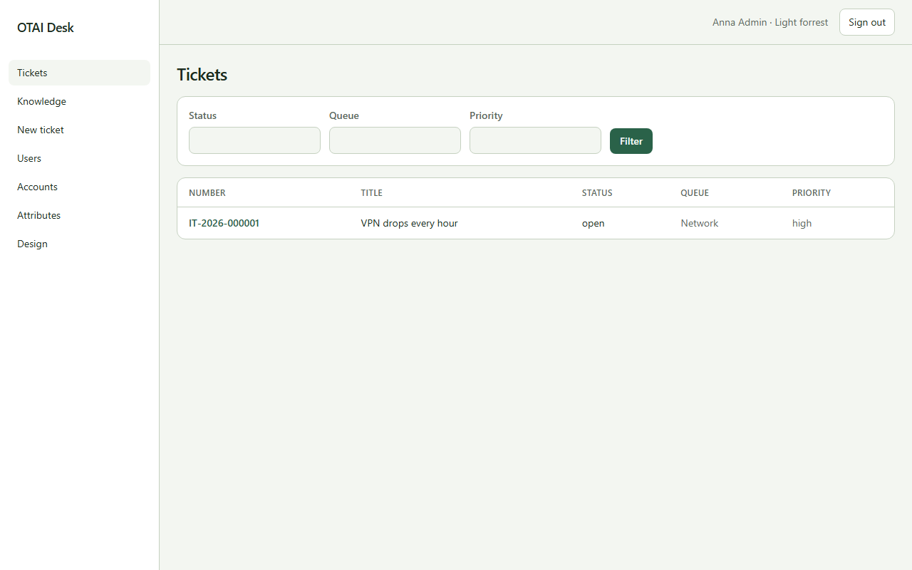
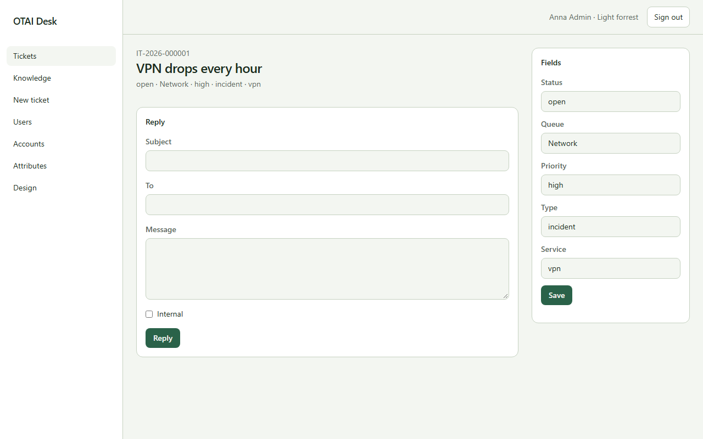
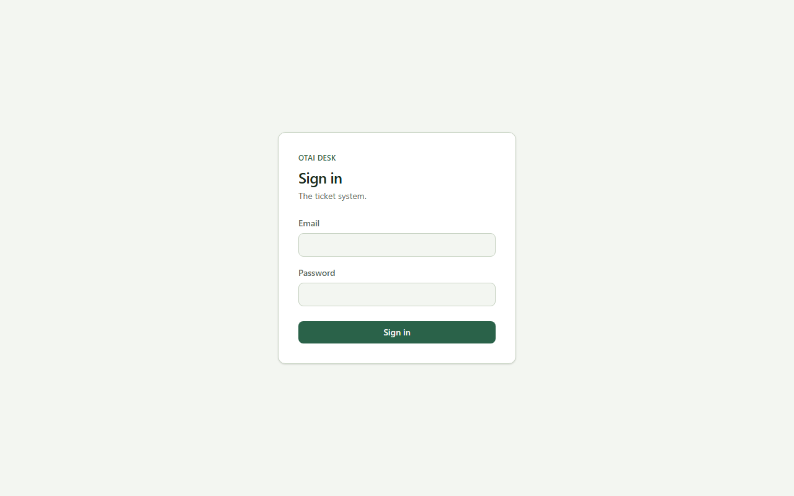

# OTAI Desk

[](https://www.gnu.org/licenses/lgpl-2.1)

**OTAI Desk** is the on-prem ticket system. One app for customers and agents. Rights differ; the app does not.

Product and handbook: [desk.openticketai.com/docs](https://desk.openticketai.com/docs/) ([English](https://desk.openticketai.com/docs/en/)).







## Run

You need the [.NET 8 SDK](https://dotnet.microsoft.com/download).

```bash
git clone https://github.com/openticketai/otai-desk.git
cd otai-desk
dotnet run --project src/OtaiDesk.csproj
```

The handbook covers sign-in, tickets, administration, and the HTTP API.

## License

OTAI Desk is GNU LGPL-2.1-or-later. See `LICENSE`.

Copyright (C) 2026 Open Ticket AI UG (haftungsbeschränkt)
Viktoriastraße 14, 68165 Mannheim, Germany
https://openticketai.com
