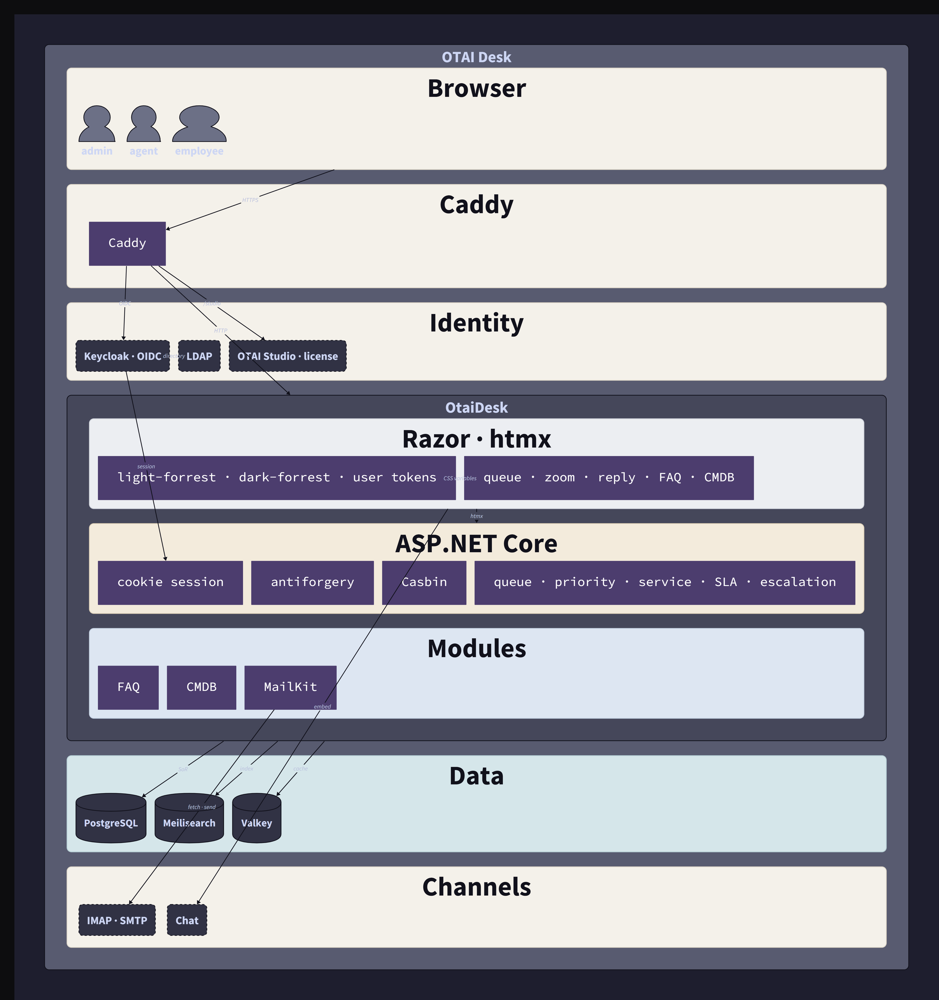
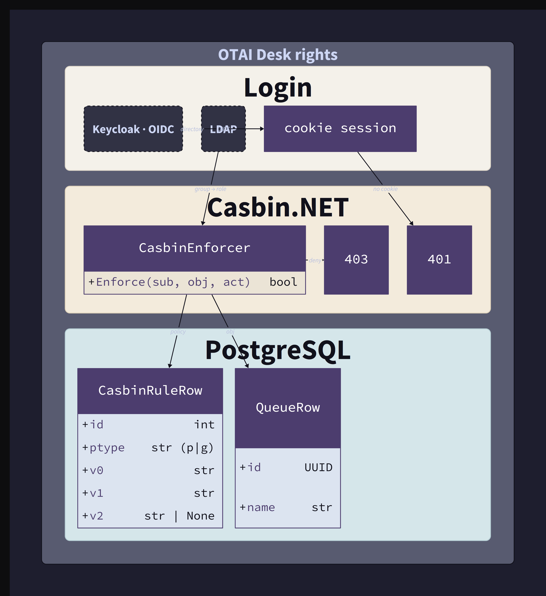
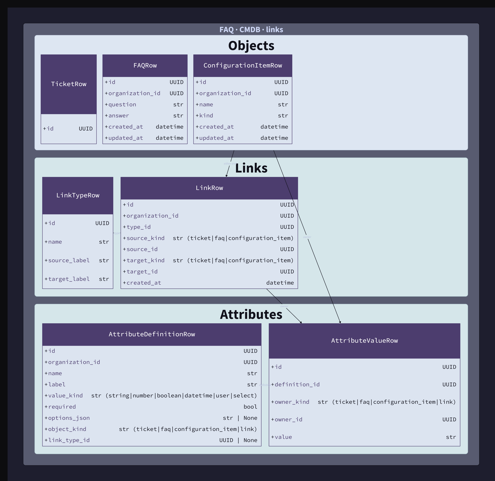

# OTAI Desk

[](https://www.gnu.org/licenses/lgpl-2.1)

**OTAI Desk** is the ticket system. One app for customers and agents. **Rights differ; the app does not.**

Source: https://github.com/openticketai/otai-desk
Postgres is the source of record. Caddy is the server. Login is OIDC (Keycloak) with LDAP behind it. Casbin decides rights.

[LD-097](docs/adr/0097-line-is-the-ticket-system.md) is the lock: one ASP.NET Core process in [`src/`](src/), Razor and htmx, designs `light-forrest` and `dark-forrest`. OTAI Studio is in the default install and stays locked until a license is set.

> Run OTAI Desk on its own. Add AI when you are ready.

## Source of truth

| Kind     | Path                                                                                                                                                                                                     |
| -------- | -------------------------------------------------------------------------------------------------------------------------------------------------------------------------------------------------------- |
| ADRs     | [`docs/adr/`](docs/adr/) (LD-082, LD-084, LD-097)                                                                                                                                                        |
| D2       | [`otai-desk-architecture`](docs/diagrams/desk/otai-desk-architecture.d2), [`otai-desk-rights`](docs/diagrams/desk/otai-desk-rights.d2), [`otai-desk-faq-cmdb`](docs/diagrams/desk/otai-desk-faq-cmdb.d2) |
| TypeSpec | [`docs/api-specs/desk-api/main.tsp`](docs/api-specs/desk-api/main.tsp)                                                                                                                                   |
| Desk app | [`src/`](src/) — one ASP.NET Core app (LD-097)                                                                                                                                                           |

Code follows ADR → D2 → TypeSpec. LD-097 retires the swappable ticket core. OTAI Desk owns the tickets.

## Picture



**Casbin** is Apache Casbin through Casbin.NET. `Enforce(subject, queue, action)` runs before the HTML. Policy rows live in Postgres. At login, an LDAP group maps onto a Casbin role. A missing cookie is 401. A deny is 403.



**FAQ** is a question and an answer. **CMDB** is a configuration item with a name and a kind. A **link** joins any two of those objects, including two of the same kind, and the link has a type ([LD-098](docs/adr/0098-line-links-any-object-with-a-type-and-attributes.md)). Types that ship: Normal, ParentChild, DependsOn, RelevantTo. Each type has a label on each end. Custom attributes hang off tickets, FAQs, configuration items, and the link. Postgres holds the rows. Meilisearch indexes FAQ and configuration items.



### Docs CLIs

```powershell
uv run otai-desk/scripts/adr.py show LD-097
uv run otai-desk/scripts/diagrams.py show otai-desk-architecture --body
uv run otai-desk/scripts/diagrams.py for-path otai-desk/src/Program.cs
uv run otai-desk/docs/diagrams/render_diagrams.py --index-only
uv run otai-desk/docs/diagrams/render_diagrams.py
```

From `otai/scripts/`, add `--product line`.

## Run locally

The app is the ASP.NET Core project in [`src/`](src/). See [`docs/roadmap.md`](docs/roadmap.md).

```powershell
dotnet run --project otai-desk/src/OtaiDesk.csproj
```

The demo stack in `deployment/demo` also runs OTAI Studio at `/studio/` and Studio API at `/studio-api/`. Studio calls this API with `Authorization: Bearer` and `OTAI_DESK_API_TOKEN`. Copy `deployment/demo/env.example` to `.env` before `docker compose up`.

External providers fail loud until `otai-ts-connector` is wired.

## License

OTAI Desk is GNU LGPL-2.1-or-later. See `LICENSE`.

Copyright (C) 2026 Open Ticket AI UG (haftungsbeschränkt)
Viktoriastraße 14, 68165 Mannheim, Germany
https://openticketai.com
