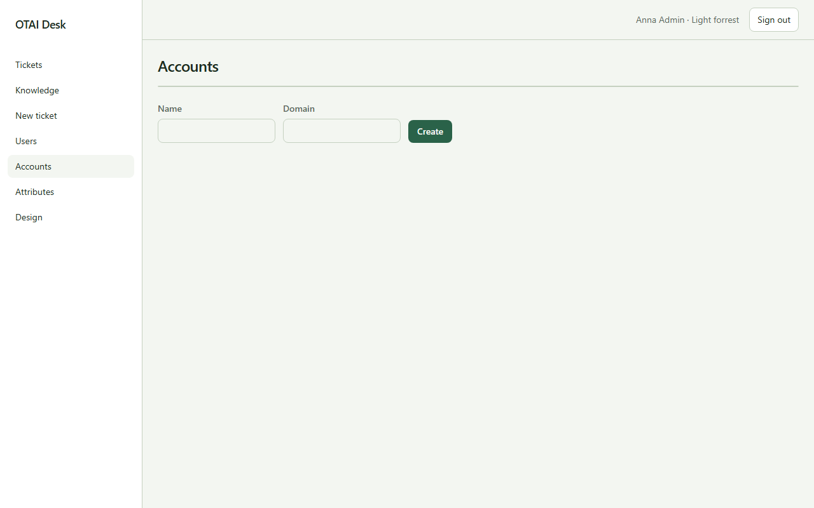

# Konten

**Konten** öffnen Sie unter `/accounts`. Recht: `users:manage`.

## Felder

- Name
- Domain

## Spalten

- Name
- Domain

## Aktionen

- Create

## Handler

- `OnGet`
- `OnPost`

## Quelle

`src/Pages/Accounts.cshtml`
