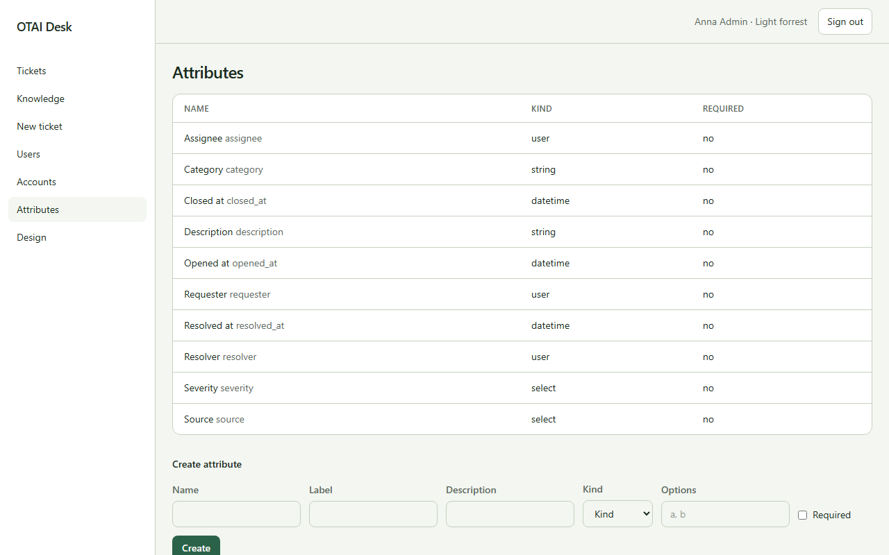

# Attribute

**Attribute** öffnen Sie unter `/attributes`. Recht: `attributes:manage`.

## Felder

- Data type
- Name
- Label
- Description
- Group
- Options

## Spalten

- Name
- Data type
- Input
- View
- Group
- Required

## Aktionen

- Create

## Handler

- `OnGet`
- `OnGetWidgets`
- `OnPost`

## Quelle

`src/Pages/Attributes.cshtml`
