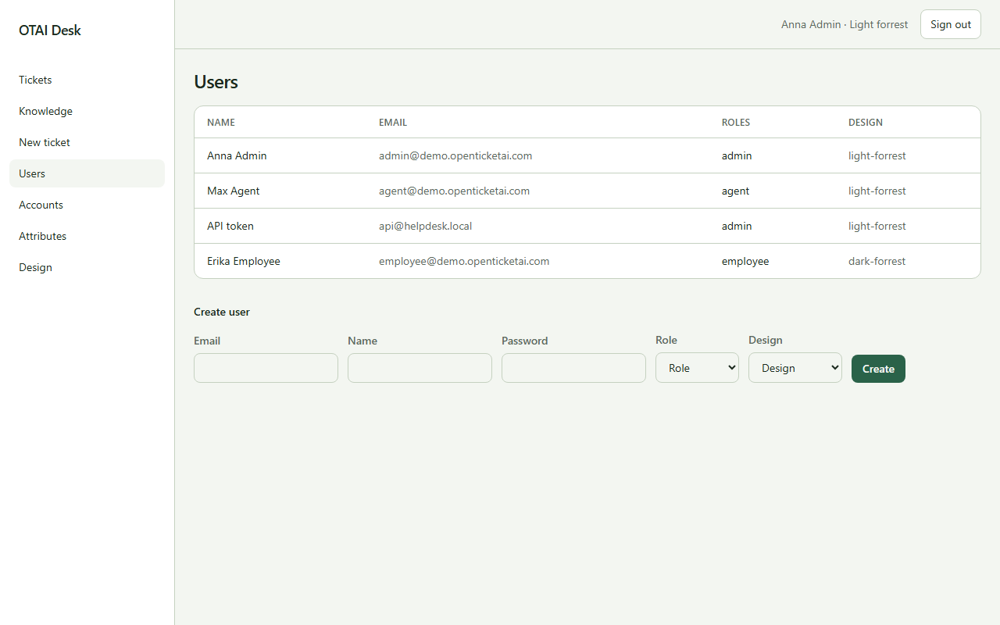

# Benutzer

**Benutzer** öffnen Sie unter `/users`. Recht: `users:manage`.

## Felder

- Role
- Design
- Email
- Name
- Password

## Spalten

- Name
- Email
- Roles
- Design

## Aktionen

- Create

## Handler

- `OnGet`
- `OnPost`

## Quelle

`src/Pages/Users.cshtml`
