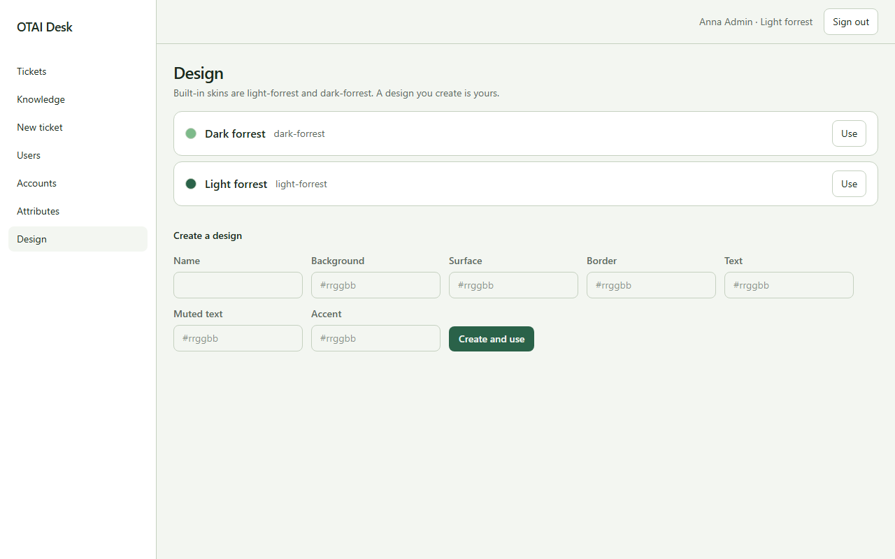

# Design

**Design** öffnen Sie unter `/designs`. Angemeldete Personen.

## Felder

- Name
- Background
- Surface
- Border
- Text
- Muted text
- Accent

## Aktionen

- Use
- Create and use

## Handler

- `OnGet`
- `OnPostSelect`
- `OnPostCreate`

## Quelle

`src/Pages/Designs.cshtml`
