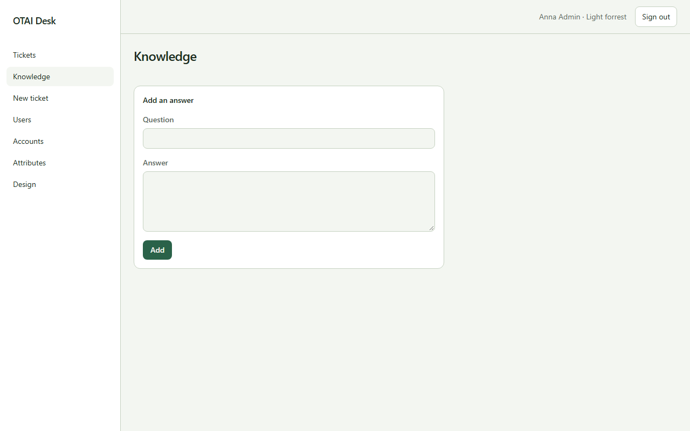

# Wissen

**Wissen** öffnen Sie unter `/knowledge`. Recht: `tickets:read`.

## Felder

- Question
- Answer

## Aktionen

- Add

## Handler

- `OnGet`
- `OnPost`

## Quelle

`src/Pages/Knowledge.cshtml`
