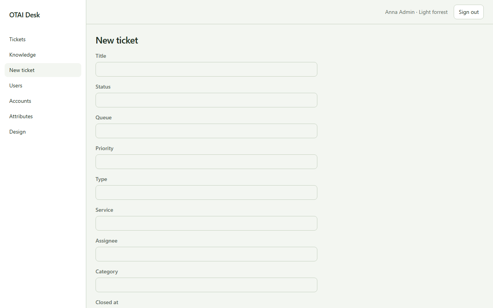

# Neues Ticket

**Neues Ticket** öffnen Sie unter `/tickets/new`. Recht: `tickets:write`.

## Felder

- Title
- Status
- Queue
- Priority
- Type
- Service

## Aktionen

- Create

## Handler

- `OnGet`
- `OnPost`

## Quelle

`src/Modules/Tickets/Pages/New.cshtml`
