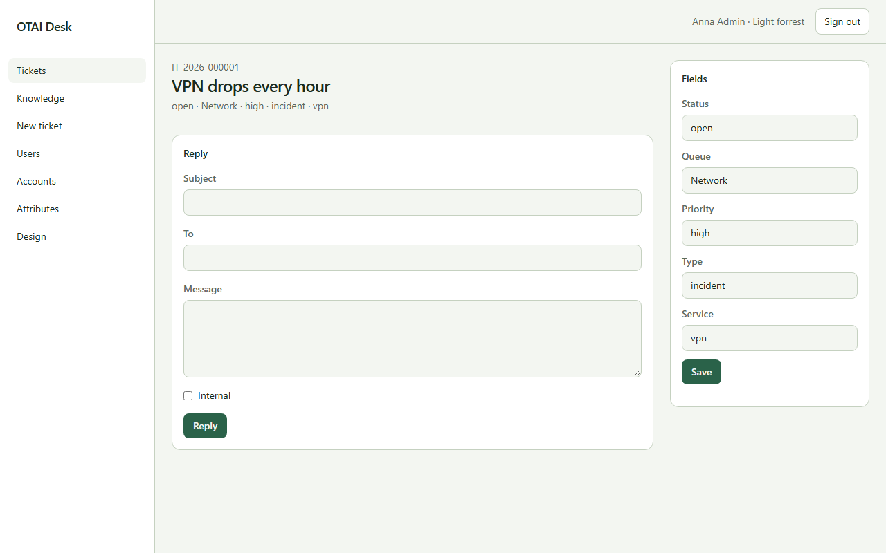

# Ticket

**Ticket** öffnen Sie unter `/tickets/{id:guid}`. Recht: `tickets:read`.

## Felder

- Subject
- To
- Message
- Status
- Queue
- Priority
- Type
- Service

## Aktionen

- Reply
- Save

## Handler

- `OnGet`
- `OnPostReply`
- `OnPostFilterFields`

## Quelle

`src/Modules/Tickets/Pages/Zoom.cshtml`
