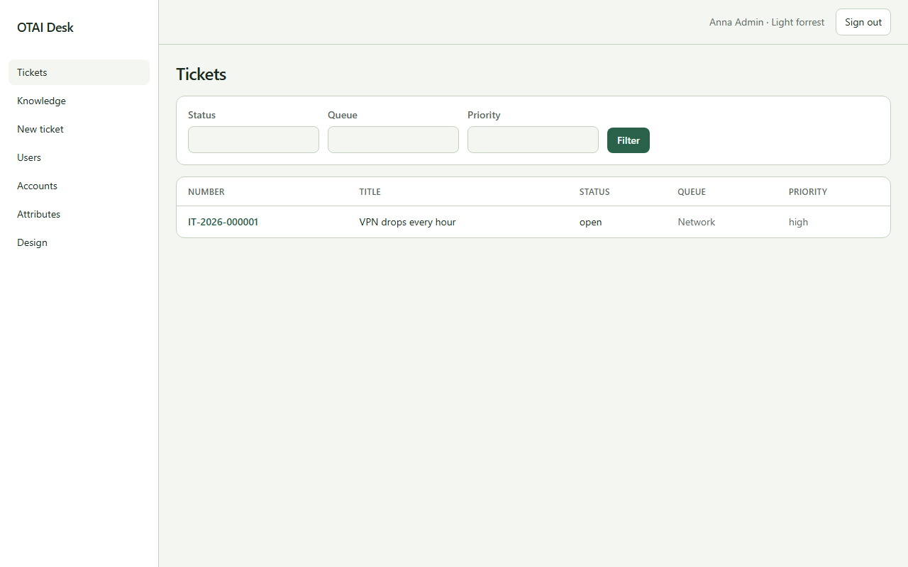

# Tickets

**Tickets** öffnen Sie unter `/`. Recht: `tickets:read`.

## Felder

- Status
- Queue
- Priority

## Spalten

- Number
- Title
- Status
- Queue
- Priority

## Aktionen

- Filter

## Handler

- `OnGet`

## Quelle

`src/Modules/Tickets/Pages/Index.cshtml`
