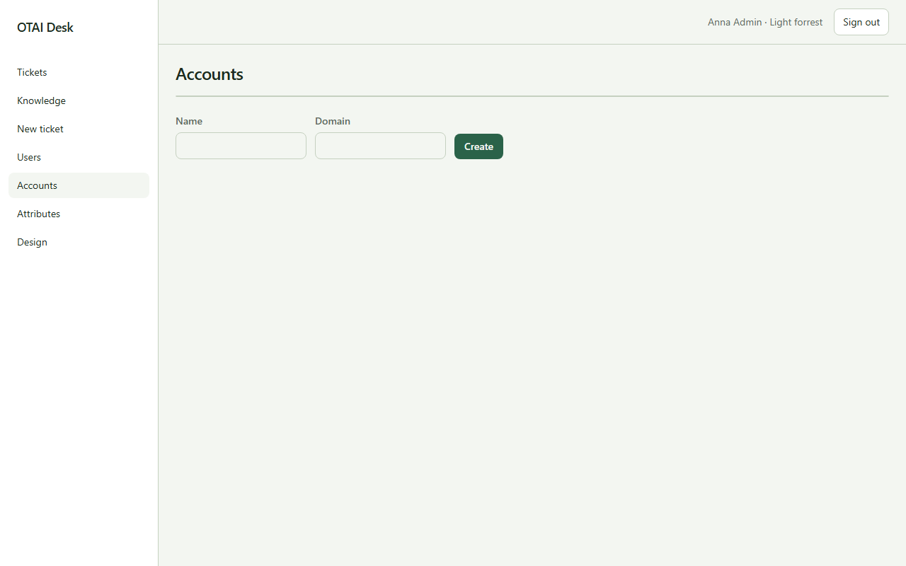

# Accounts

Open **Accounts** at `/accounts`. Right: `users:manage`.

## Fields

- Name
- Domain

## Columns

- Name
- Domain

## Actions

- Create

## Handlers

- `OnGet`
- `OnPost`

## Source

`src/Pages/Accounts.cshtml`
