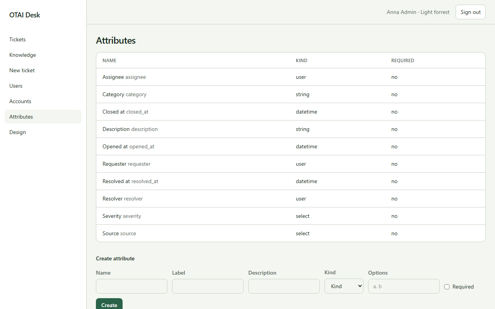

# Attributes

Open **Attributes** at `/attributes`. Right: `attributes:manage`.

## Fields

- Data type
- Name
- Label
- Description
- Group
- Options

## Columns

- Name
- Data type
- Input
- View
- Group
- Required

## Actions

- Create

## Handlers

- `OnGet`
- `OnGetWidgets`
- `OnPost`

## Source

`src/Pages/Attributes.cshtml`
