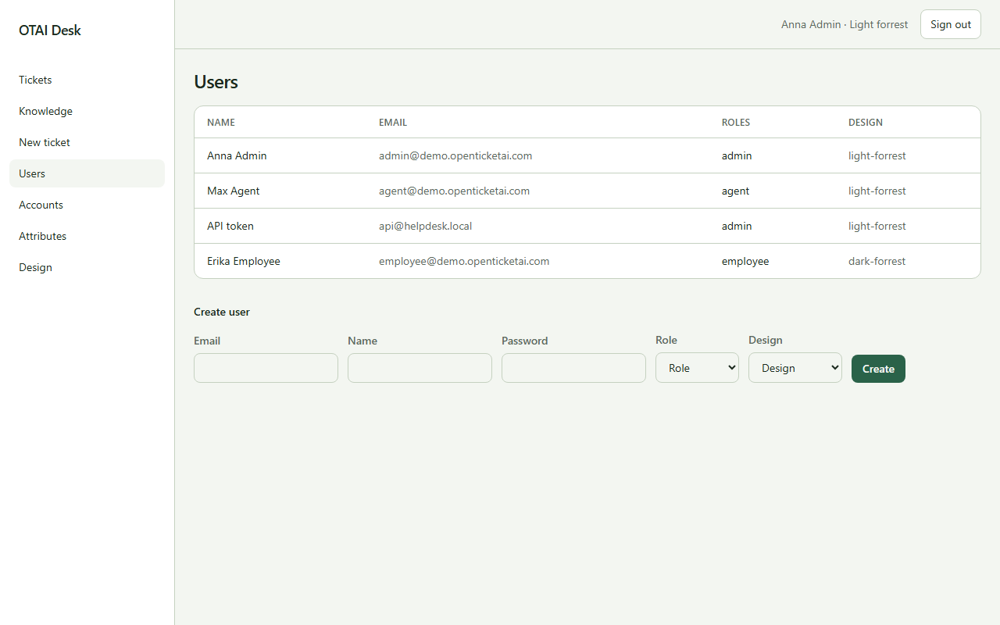

# Users

Open **Users** at `/users`. Right: `users:manage`.

## Fields

- Role
- Design
- Email
- Name
- Password

## Columns

- Name
- Email
- Roles
- Design

## Actions

- Create

## Handlers

- `OnGet`
- `OnPost`

## Source

`src/Pages/Users.cshtml`
