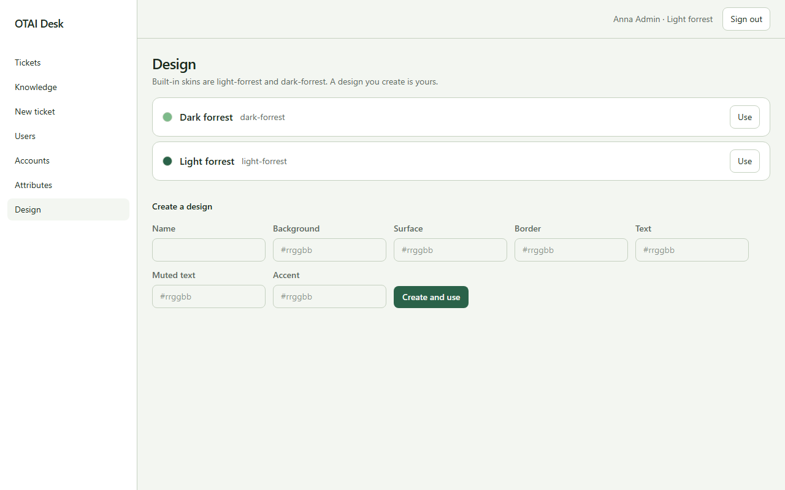

# Design

Open **Design** at `/designs`. Signed-in people.

## Fields

- Name
- Background
- Surface
- Border
- Text
- Muted text
- Accent

## Actions

- Use
- Create and use

## Handlers

- `OnGet`
- `OnPostSelect`
- `OnPostCreate`

## Source

`src/Pages/Designs.cshtml`
