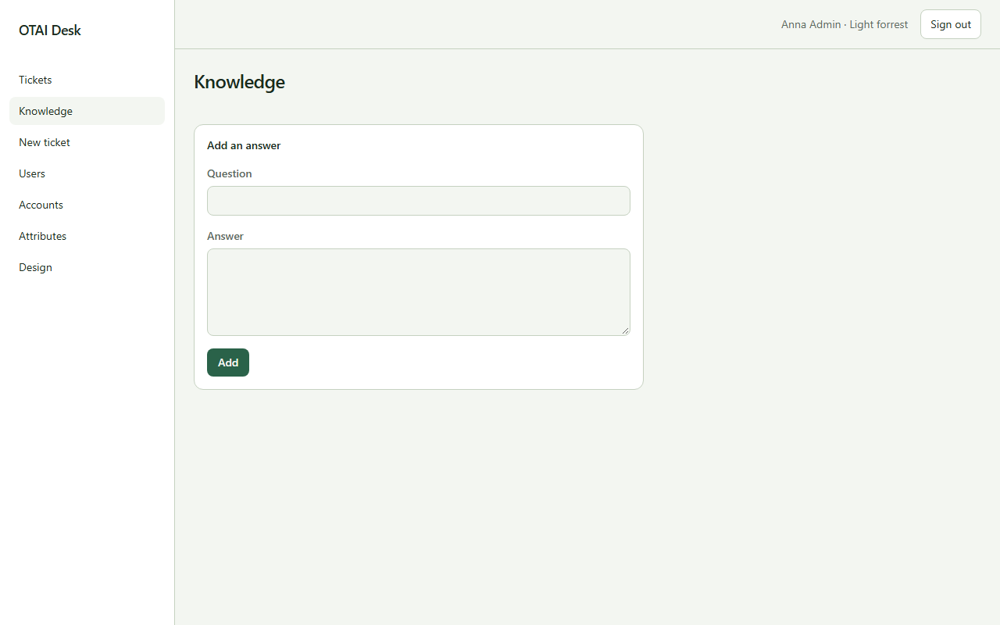

# Knowledge

Open **Knowledge** at `/knowledge`. Right: `tickets:read`.

## Fields

- Question
- Answer

## Actions

- Add

## Handlers

- `OnGet`
- `OnPost`

## Source

`src/Pages/Knowledge.cshtml`
