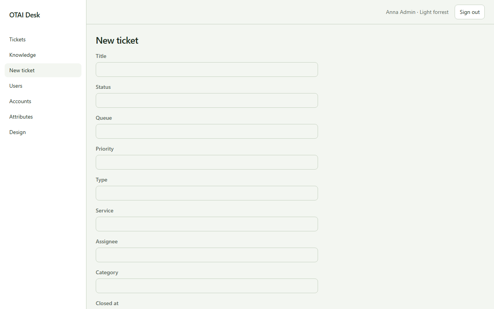

# New ticket

Open **New ticket** at `/tickets/new`. Right: `tickets:write`.

## Fields

- Title
- Status
- Queue
- Priority
- Type
- Service

## Actions

- Create

## Handlers

- `OnGet`
- `OnPost`

## Source

`src/Modules/Tickets/Pages/New.cshtml`
