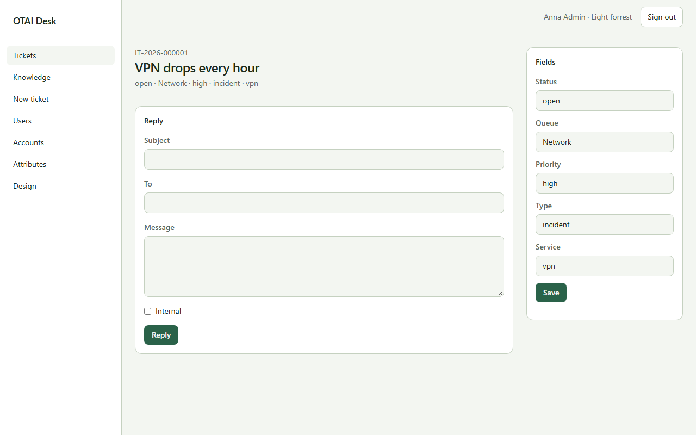

# Ticket

Open **Ticket** at `/tickets/{id:guid}`. Right: `tickets:read`.

## Fields

- Subject
- To
- Message
- Status
- Queue
- Priority
- Type
- Service

## Actions

- Reply
- Save

## Handlers

- `OnGet`
- `OnPostReply`
- `OnPostFilterFields`

## Source

`src/Modules/Tickets/Pages/Zoom.cshtml`
