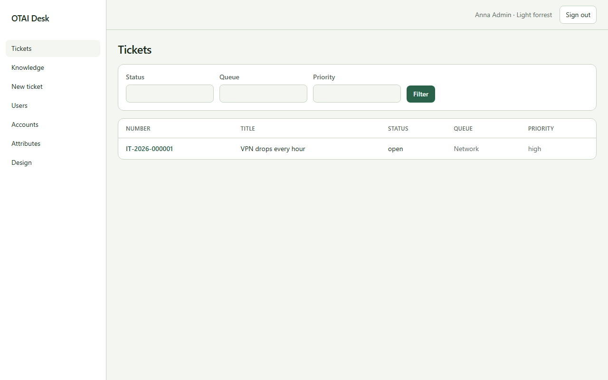

# Tickets

Open **Tickets** at `/`. Right: `tickets:read`.

## Fields

- Status
- Queue
- Priority

## Columns

- Number
- Title
- Status
- Queue
- Priority

## Actions

- Filter

## Handlers

- `OnGet`

## Source

`src/Modules/Tickets/Pages/Index.cshtml`
