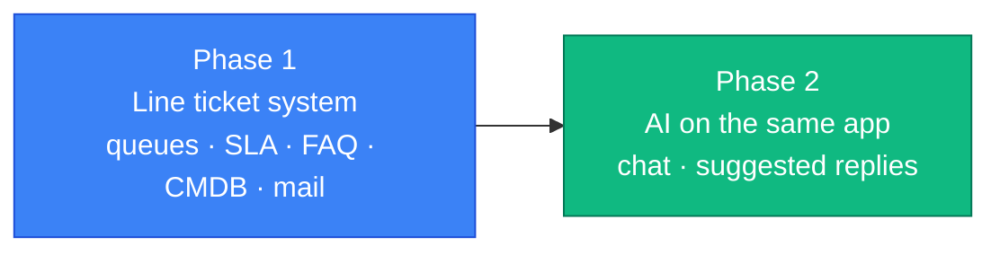

# OTAI Desk — Product Roadmap

This document captures the **sequencing strategy** for OTAI Desk: what we
build first, why, and how each phase unlocks the next. Locked product
rules: [`product-decisions.md`](./product-decisions.md). Phase 1 detail:
[`phase-1-customer-portal-plan.md`](./phase-1-customer-portal-plan.md)
(LD-082).

## Guiding principle: Line is the ticket system

Line owns the tickets ([LD-097](./adr/0097-line-is-the-ticket-system.md)). Customers and agents share one app; rights differ. Ticket behavior matches OTOBO: queue, priority, service, SLA, escalation. Postgres is the source of record. There is no replica of another ticket system.

## Product principles

- **One portal, not two products** — no separate customer-portal vs
  agent-portal apps (LD-082).
- **AI-native core first** — agents, approval, and audit.
- **No canned responses in Desk** — AI-suggested replies replace static templates.
- **No plugin kernel** — features are modules in this process.
- **Casbin owns rights** — policies in Postgres. OIDC identifies the user. LDAP is the directory.

## Phases

### Phase 1 — The ticket system

**Goal:** One app. Postgres holds the tickets. Picture: [`otai-desk-architecture`](./diagrams/desk/otai-desk-architecture.d2).

**What it does:**

- Caddy in front. Login through Keycloak (OIDC). LDAP is the directory.
- Casbin decides rights, including who can use a queue.
- Tickets follow OTOBO behavior: queue, priority, service, SLA, escalation, articles.
- FAQ and a small CMDB. Meilisearch indexes them. Valkey is only a cache.
- MailKit fetches IMAP and sends SMTP.
- OTAI Studio is installed and stays locked until a license is set.

### Phase 2 — AI on the same app

**Goal:** Chat and suggested replies on this ticket system, not a second helpdesk.

**What it adds:**

- Chat embedded in the Razor shell, answering from FAQ before a ticket exists.
- On escalate: create a ticket in Line.
- Agent view gets AI-suggested replies (still not canned responses).
- Studio stays outside the Line process. A license unlocks it.

AI items land under [OPE-27](https://linear.app/openticketai/issue/OPE-27)
and [OPE-32](https://linear.app/openticketai/issue/OPE-32).

## How this relates to existing docs

- **Diagram:** [`otai-desk-architecture`](./diagrams/desk/otai-desk-architecture.d2) (LD-097).
- The older phase-1 write-up (`phase-1-customer-portal-plan.md`) describes a portal over another ticket system. LD-097 retires that. The phase-1 drawing is removed.
- Studio ships in the install. A license unlocks the paid product ([LD-047](../../otai/docs/adr/0047-unified-license-type-entitlements.md)).
